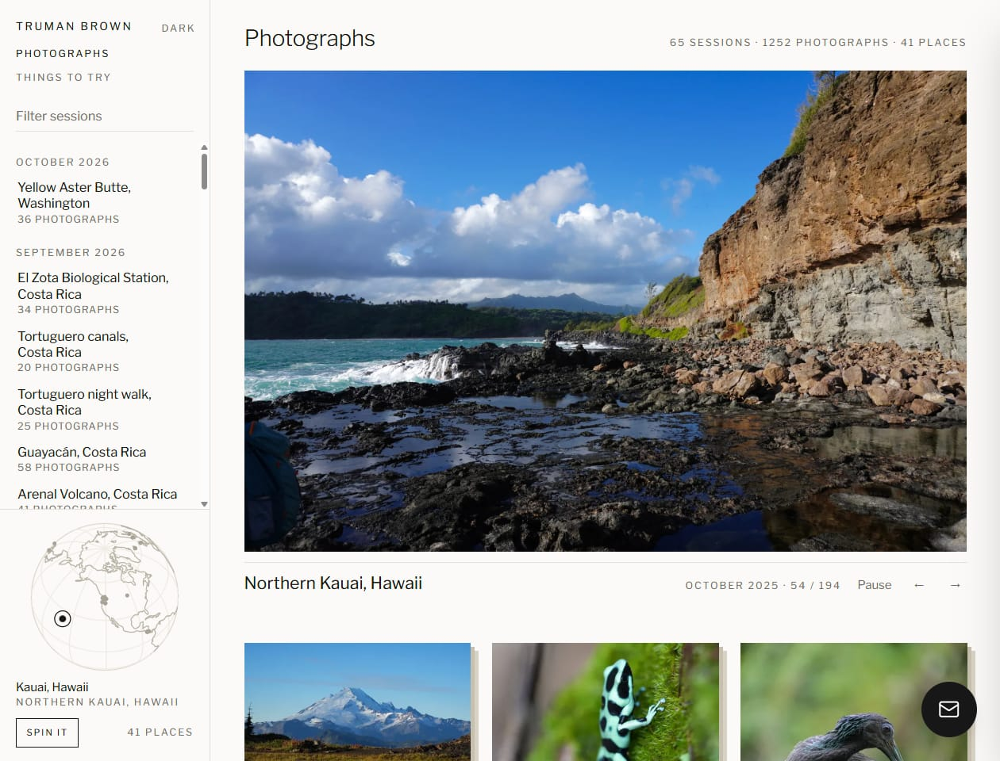

# photography-website

The code behind **[trumanbrown.com](https://trumanbrown.com)**, my wildlife, landscape and travel photography site.

[](https://github.com/TrumanBrown/photography-website/actions/workflows/build-and-deploy.yml)
[](https://github.com/TrumanBrown/photography-website/actions/workflows/lint.yml)
[](https://github.com/TrumanBrown/photography-website/actions/workflows/codeql.yml)

<a href="https://trumanbrown.com">
  <picture>
    <source media="(prefers-color-scheme: dark)" srcset="docs/images/home-dark.jpg">
    
  </picture>
</a>

Try it: [the photo archive](https://trumanbrown.com), [Things to try](https://trumanbrown.com/hobbies/) (small interactive nature toys) and [Narrow nature](https://trumanbrown.com/hobbies/narrow-nature/), a daily puzzle where you guess where and when six species were seen together.

## What's worth a look

- **Security.** A strict Content Security Policy with hashed inline scripts and no `'unsafe-inline'` scripts, HSTS preload, keyless OIDC deploys through two least-privilege Azure identities, SHA-pinned actions, CodeQL, Dependabot and secret scanning with push protection. Photos have their GPS removed before they're published. [docs/security.md](docs/security.md)
- **Infrastructure as code.** Every Azure resource is in Bicep and deploys from a manual workflow behind a GitHub environment. [docs/iac-bicep.md](docs/iac-bicep.md)
- **CI/CD.** Builds run on every push and every hour, pick up new photos from Blob Storage, and move the image variants back to Blob so the Static Web Apps deploy stays a few megabytes. Azure sign-ins retry, so a GitHub token hiccup doesn't fail a deploy. [docs/cicd.md](docs/cicd.md)
- **Photo pipeline.** A vision model looks at each photo once and writes its caption and alt text, with the species taken from my own iNaturalist observations and facts checked against Wikipedia. The same pipeline posts to Instagram three times a day in captions that sound like me, and Instagram now sends the site more referred visits than any other source. [docs/photos.md](docs/photos.md), [The Instagram pipeline](#the-instagram-pipeline)
- **Cost.** About $5 a month, domain included. [What it costs](#what-it-costs)

## About the project

A personal website built around a photography portfolio, with a **Hobbies** section of small hand-drawn interactive toys, a browser-based **admin panel** for editing content, a contact form, and privacy-friendly **traffic analytics**. Photos live in Azure Blob Storage and the site is a static Astro build hosted on Azure Static Web Apps. Drop a folder of photos into Blob and the site picks them up on the next build.

The project started as a photography portfolio and has grown into a small personal site. The portfolio is still the home page; everything else (hobbies, admin, analytics, the contact form) sits beside it and can be toggled off in [site.config.ts](site.config.ts).

**Why each piece exists**: see [docs/architecture.md](docs/architecture.md).
**New to any of this?** Start with [docs/glossary.md](docs/glossary.md).

---

## Quick links

| Topic | Doc |
|---|---|
| Product experience, measured baseline, design decisions, and roadmap | [docs/product-experience.md](docs/product-experience.md) |
| What is Astro, SWA, Blob, CDN, and why each one | [docs/architecture.md](docs/architecture.md) |
| What Azure resources exist and what each costs | [docs/azure.md](docs/azure.md) |
| What Infrastructure-as-Code (Bicep) is and what each `.bicep` file does | [docs/iac-bicep.md](docs/iac-bicep.md) |
| How the GitHub Actions workflows work and why | [docs/cicd.md](docs/cicd.md) |
| How a photo travels from your camera to the live site | [docs/image-pipeline.md](docs/image-pipeline.md) |
| The optional **Hobbies** section + interactive islands | [docs/hobbies.md](docs/hobbies.md) |
| Editing session metadata from the browser (`/admin`) | [docs/admin.md](docs/admin.md) |
| Privacy-friendly traffic analytics (`/admin` Analytics tab) | [docs/analytics.md](docs/analytics.md) |
| Photo captions and session descriptions, written from the photos | [docs/photos.md](docs/photos.md) |
| Posting photos to Instagram a few a day, automatically | [docs/social.md](docs/social.md) |
| How the site is hardened (CSP, HSTS, CI identities, photo location) | [docs/security.md](docs/security.md) |
| Reporting a vulnerability | [SECURITY.md](SECURITY.md) |
| Running locally, npm, dev server, fixtures, tests | [docs/local-dev.md](docs/local-dev.md) |
| **What personal info ends up in the public repo (and what doesn't)** | [docs/privacy.md](docs/privacy.md) |
| Picking the project up cold: hard-won lessons, scripts, open items | [docs/session-handoff.md](docs/session-handoff.md) |
| Glossary of every term used here | [docs/glossary.md](docs/glossary.md) |

---

## Tech at a glance

- **Frontend:** Astro 5 + Tailwind v3 (static build, near-zero JS), see [docs/architecture.md](docs/architecture.md)
- **Interactive hobbies:** hand-drawn canvas islands (aquarium, tide pooling, fishing, birding selfie-to-bird, herping night drive, hiking trail studio) plus the Narrow nature daily puzzle, each card illustrated with a stipple plate drawn from one of the photos, see [docs/hobbies.md](docs/hobbies.md)
- **Dynamic API:** three Azure Functions bundled with SWA (contact form, admin session manager, analytics beacon), see [docs/architecture.md](docs/architecture.md)
- **Admin + analytics:** browser `/admin` panel gated by GitHub sign-in, cookieless traffic metrics, see [docs/admin.md](docs/admin.md) and [docs/analytics.md](docs/analytics.md)
- **Hosting:** Azure Static Web Apps (Free tier), see [docs/azure.md](docs/azure.md)
- **Storage:** Azure Blob Storage across six containers (`originals`, `derivatives`, `variants`, `hobby-media`, plus private `metadata` and `incoming`), see [docs/image-pipeline.md](docs/image-pipeline.md)
- **Galleries:** sessions open on a banner crop then a justified grid; the lightbox always ends on the full-resolution original, image data untouched, while painting in ~80 ms, see [docs/image-pipeline.md#viewing-full-resolution-without-the-wait](docs/image-pipeline.md#viewing-full-resolution-without-the-wait)
- **Domain + DNS:** Azure App Service Domain + Azure DNS
- **IaC:** Bicep, see [docs/iac-bicep.md](docs/iac-bicep.md)
- **CI/CD:** GitHub Actions, OIDC federation (no long-lived secrets) with a blob-only identity for builds and a separate one for the manual infra deploy, see [docs/cicd.md](docs/cicd.md)
- **Cost target:** about $5/month at personal traffic (incl. `.com` domain), see [What it costs](#what-it-costs) and [docs/azure.md#monthly-cost](docs/azure.md#monthly-cost)
- **What about your name/address/etc. in this repo?** See [docs/privacy.md](docs/privacy.md)

---

## The Instagram pipeline

The site also runs my photography Instagram: three photos a day plus a story, with nothing for me to do after an upload. The vision model's one look at each photo feeds the post too, the species comes from my own iNaturalist observation, and a Logic App timer publishes each post exactly once through Instagram's Graph API. Every caption points back to the full-resolution photo on the site. From October 10, 2026, when posting started, to October 27, the Instagram bio link sent 21 of the site's 208 visits, against 5 from every other site put together ([analytics](docs/analytics.md)).

The first captions read like alt text, so I rewrote a dozen of them by hand, and the generator learns from those rewrites:

| The pipeline wrote | I rewrote it to |
| --- | --- |
| Groove-billed ani (Crotophaga sulcirostris) munching on an insect on a mossy post, Bijagua, Alajuela Province, Costa Rica. Such an interesting, unique beak on it. | Saw this Groove-billed ani (Crotophaga sulcirostris) munching on some insect in Bijagua. Such a unique bird, the beak goes so far up its head, almost looks like a horn lol 🐦 |
| Ran into this northwestern garter snake (Thamnophis ordinoides) with its mouth open among the grass and fallen leaves around Puget Sound. Can't tell what was going on, but that's such a big expression for a small snake lol 😅 | Ran into this northwestern garter snake (Thamnophis ordinoides) with some gunk on his jaws. Looks like he just finished a big meal, was pretty lethargic when moving 🐍 |

The rewrites live in two Markdown skills, [truman-voice](.github/skills/truman-voice/SKILL.md) and [caption-voice](.github/skills/caption-voice/SKILL.md), that go into the prompt with every batch of posts ([voice.mjs](scripts/photos/voice.mjs)). Code then checks each opening before it's kept: no backstory my trip notes don't back up, no opener that repeats a recent post, one emoji of the animal or the scene, and the species name filled in from the verified identification so it can't be wrong. The account isn't named anywhere in this repository. Setup and every rule: [docs/social.md](docs/social.md).

---

## Local development (TL;DR)

Full version in [docs/local-dev.md](docs/local-dev.md).

```bash
npm ci
npm run fixtures           # synthetic sessions for local dev
npm run dev                # → http://localhost:4321
```

`npm run fixtures:many` generates ~40 sessions across 5 years so you can see how the sidebar feels at scale.

Before pushing, run what CI runs:

```bash
npm test                   # Vitest: site helpers, API functions, prebuild, photo + social pipelines
npm run lint               # ESLint
npm run check              # CSP hash drift + astro check (types and content schemas)
npm run build              # production build into dist/
```

---

## First-time Azure setup

Full walkthrough with explanations in [docs/azure.md](docs/azure.md) and [docs/cicd.md](docs/cicd.md). The minimal sequence:

### 0. Prereqs

- Azure CLI (`az`) installed and `az login` done
- GitHub CLI (`gh`) installed and `gh auth login` done (logged in as the GitHub account that owns the repo)
- An empty GitHub repo created and this code pushed to `main`
- The subscription ID + tenant ID of your Azure subscription

### 1. Fill in placeholders

Edit [site.config.ts](site.config.ts):
- `ownerName`, your full name (drives the footer, page metadata and structured data; **becomes public when you push**)
- `siteTitle`, `siteDescription`, taste
- `domain`, apex domain you'll register (e.g. `<yourname>.com`)
- `copyrightStartYear`, current year on first deploy
- `prints`, `true` to take print and licensing inquiries: a Prints button on session photos, a `/prints` page in the footer, and licensing data for Google Images. Inquiries arrive through the contact form; there's no shop. Set `false` if you don't sell prints. Details in [docs/product-experience.md](docs/product-experience.md#prints-and-licensing-inquiries).

Edit [infra/main.parameters.json](infra/main.parameters.json):
- `githubOwner`, your GitHub username/org
- `domainName`, leave `""` on first deploy if you want infra up before registering a domain; fill in and re-deploy later

> Full inventory of what becomes public and what stays private: [docs/privacy.md](docs/privacy.md).

### 2. Bootstrap the deploy identity

```bash
./scripts/setup-federated-credential.sh <subscription-id> <github-owner> <github-repo>
```

It prints three values. Add them as repo secrets (Settings → Secrets and variables → Actions):
- `AZURE_CLIENT_ID`
- `AZURE_TENANT_ID`
- `AZURE_SUBSCRIPTION_ID`

This identity can change the whole subscription, so it trusts only the `prod`
GitHub Environment that the Infra workflow deploys from. Create that environment
under **Settings → Environments** and limit its deployment branches to `main`.
Everything else (builds, captions, Instagram) signs in as a second identity that
the first Infra run creates, with access to the site's blobs only. What this
does and why: [docs/cicd.md](docs/cicd.md#two-identities-least-privilege-by-job).

### 3. (Optional) Add a PAT for secret auto-write

If you want the **Infra (Bicep)** workflow to auto-write `AZURE_STATIC_WEB_APPS_API_TOKEN`, `AZURE_STORAGE_ACCOUNT` and `AZURE_DEPLOY_CLIENT_ID` (the build identity) back into repo secrets, add a fine-grained PAT with `Secrets: read/write` on this repo as `GH_PAT_FOR_SECRETS`. Otherwise run `./scripts/bootstrap-swa-token.sh <resource-group> <swa-name> <owner/repo>` by hand after the first deploy.

### 4. Run the Infra workflow

GitHub → **Actions** tab → **Infra (Bicep)** → **Run workflow** → environment `prod`.

This deploys the whole Azure stack. Everything it creates is enumerated in [docs/iac-bicep.md](docs/iac-bicep.md#what-the-bicep-deploys-resource-by-resource).
It also configures the SWA Functions with the storage connection, a private
analytics salt, and the GitHub user who ran the workflow as the initial admin.

### 5. Register the domain (interactive, one-time)

```bash
az appservice domain create \
  --resource-group rg-photography-prod \
  --hostname yourdomain.com \
  --contact-info @contact.json \
  --accept-terms
```

`contact.json` format: <https://learn.microsoft.com/azure/app-service/manage-custom-dns-buy-domain>. **Gitignored**: never commit it.

Then set `domainName` in `infra/main.parameters.json` and re-run the Infra workflow, then bind the apex/www domains:

```bash
./scripts/bind-domain.sh rg-photography-prod swa-photography-prod yourdomain.com
```

### 6. Update `site.config.ts` with the real Blob host

After the first infra deploy, set `blobHost` in [site.config.ts](site.config.ts) to the actual storage account hostname (printed in the deploy output), and put the same host in the two `blob.core.windows.net` sources of the Content-Security-Policy in [staticwebapp.config.json](staticwebapp.config.json) (`npm run check:csp` fails until they match). For uploads, set `AZURE_STORAGE_ACCOUNT` in `.env`. Commit and push.

### 7. Tell Google about the site (optional)

In [Google Search Console](https://search.google.com/search-console), add a Domain property for your domain and put the TXT value it gives you at the apex, beside the Static Web Apps token:

```bash
az network dns record-set txt add-record -g rg-photography-prod -z yourdomain.com -n @ \
  --value "google-site-verification=<value from Google>"
```

Never delete the apex TXT record set: both values live in it. Once Google verifies the domain, submit `https://yourdomain.com/sitemap-index.xml` and `https://yourdomain.com/image-sitemap.xml`. "Couldn't fetch" right after a push usually means a deploy was running, so submit again later. The aim is for session pages to come up when people search the places in their titles.

---

## Adding a session

The easy way, drop photos in `staging/` and run the upload script:

```bash
# 1. Put your photos in a named folder under staging/
mkdir -p staging/2026-japan
cp ~/photos/japan/*.jpg staging/2026-japan/

# 2. Upload to Blob Storage and trigger a build
./scripts/upload-session.sh 2026-japan --build
```

The script handles Azure auth (auto-switches tenant via `.env`), filters to
accepted file types (JPG, HEIC, PNG, TIFF, RAW), uploads to a private inbox
(the `incoming` container), and optionally triggers the build. See [staging/README.md](staging/README.md).
The argument must name one direct child of `staging/`; every session folder must
map to a unique public slug and contain at least one image.

Phones write where each photo was taken into the file, and anyone with a
published photo's link can download it. So uploads wait in that private inbox,
and the build removes the GPS position before publishing them to `originals`.
Only metadata changes: the published file is byte for byte the image you shot,
at full resolution, camera settings included. It all runs in GitHub Actions, so
uploading needs nothing beyond `az` (and `gh` for `--build`). Details:
[docs/security.md](docs/security.md#photo-locations).

The folder name becomes the session's web address, and captions read place
names from it. So the script stops on a misspelled state, country or island
(`crater-lake-oreogn-sep-2025`) and says what to rename it to. Add
`--keep-names` to upload it as it is.

### Setting session metadata

Two options:

- **Admin panel** (no code): visit `/admin`, sign in with GitHub, edit title,
  cover thumbnail, location, description, and display order in the browser.
  See [docs/admin.md](docs/admin.md).
- **`_session.json` sidecar**: add this file at the session's prefix root in Blob
  Storage (the admin panel writes the same file):
  ```json
  {
    "title": "Japan, Spring 2026",
    "date": "2026-03-15",
    "location": "Tokyo → Kyoto",
    "description": "Two weeks chasing cherry blossoms.",
    "cover": "DSC03421.jpg",
    "order": 5
  }
  ```

`date` must be a real `YYYY-MM-DD` calendar date. Prebuild validates the whole
sidecar and fails with the field path instead of publishing partial defaults.

`cover` picks the card thumbnail and the link-preview image. The session page
opens on a separate wide banner, which is a hard crop: upright frames lose most
of their height. Set `"banner"` to the filename you want there and it is used
as-is. Leave it out and the banner derives one: the cover when the cover is
landscape enough, otherwise the widest photograph in the session. Add an
optional `"bannerFocus"` — any CSS `object-position`, e.g. `"center 30%"` — to
steer where that crop sits.

### Title and description conventions

Session titles follow **`Place, Region, Month Year`**:

```
Zhangjiajie, Hunan, April 2026
Gunn Peak, Washington, June 2026
Tortuguero night walk, Costa Rica, September 2026
```

The specific place goes first because that's the word people search for, and
the shape stays the same across the archive so the session list reads as one
set rather than thirty separate naming decisions. Keep the month in step with
the date the page displays, which prebuild derives from EXIF.

Descriptions render on the **session page only** — the home-page cards show
title, date, location and photo count. The description was previously on both,
which duplicated the same sentences across two URLs for no benefit.

A species is only ever named from your own iNaturalist observation of that
photo. Everything else gets plain words ("a tree frog", "a heron"): a wrong
species name is worse than no name at all for a naturalist audience, and it
can rank the page for something it isn't.

Changes go live on the next build, click **Run workflow** on `Build and Deploy`
(or **Rebuild Site** in the admin panel) for a ~5 minute publish, or wait for the cron.

Full pipeline walkthrough: [docs/image-pipeline.md](docs/image-pipeline.md).

### Captions and descriptions, written for you

After a build publishes new photos, the **Photo captions** workflow looks at
each one once with a vision model, matches it to your iNaturalist
observations, and writes:

- **a caption for every photo**, e.g. `Northwestern garter snake (Thamnophis
  ordinoides) coiled on a mossy log, Sauk Mountain` or `Mount Baker reflected
  in a tarn, Yellow Aster Butte`: specific and plain, in the words people
  search with, with no poses or background blur. It's the photo's `alt` text
  and lightbox caption, which is what image search actually reads.
- **a description for every session**, written from all of its photos'
  captions and identifications: the place and the main subjects by name first
  (it's the search snippet), with a light touch of your voice and any notes
  you've left about the trip.

Both land in the session's `_session.json` and the site rebuilds, usually
within half an hour of the upload. Edit either in `/admin` and your version
stays: the pipeline never overwrites text you've changed.

| Field | If you set it | If you leave it blank |
| --- | --- | --- |
| `title` | kept as-is | drafted, `Place, Region, Month Year` |
| `location` | kept as-is | drafted |
| `description` | kept as-is | **written from every photo in the session** |
| per-image `caption` | kept as-is | **written from the photo and its iNaturalist ID** |

It needs a vision model. The recommended one is keyless Azure OpenAI in your
own tenant, so photos never leave it and there's no API key to leak. Setup,
how identifications work, the checks every caption and description has to
pass, and commands to preview or redo anything:
[docs/photos.md](docs/photos.md).

### Instagram, a few photos a day (optional)

The same pipeline can post the archive to an Instagram account: 3 photos a
day by default, each one once, in an order that mixes sessions and subjects
rather than going oldest to newest, with one post in every three a landscape
or place. Each post is:

- **the photo at Instagram's full resolution** (1440 px), whole when it fits
  Instagram's shape. Frames too tall or too wide for it are cropped to fit,
  from the middle unless one end is empty sky, water or blur.
- **a caption written from the photo's own record**: an opening in your voice
  (how you came across it, the species from your iNaturalist identification of
  that exact photo with its scientific name, what it's doing and your reaction,
  with one emoji), the place on its own line, a fun fact about the species or
  the place taken from Wikipedia and checked against the article, the camera
  and lens, five hashtags built from data, alt text, and a last line sending
  people to the full-resolution photo on your site through the link in your
  bio. It only says what you were doing (a hike, a boat tour) when the trip's
  name or your private trip notes say so. How it sounds comes from your own
  rewrites, kept in the
  [truman-voice](.github/skills/truman-voice/SKILL.md) and
  [caption-voice](.github/skills/caption-voice/SKILL.md) skills; edit those
  to change it.

It can also post **one story a day**, at a different time each day: a photo
from the archive, vertical ones first, with nothing added
(`SOCIAL_STORIES=true`).

**What happens when you upload a session**, with nothing else to do:

1. `./scripts/upload-session.sh <folder> --build` uploads the photos and starts
   a build. The photos go live without captions.
2. The build notices photos the pipeline hasn't seen and starts the **Photo
   captions** workflow. It looks at each new photo once, matches it to your
   iNaturalist observations, writes the captions and the session description,
   and redeploys the site (usually 15 to 30 minutes after the upload).
3. The same run puts the new photos into the Instagram plan alongside the
   rest of the archive. Sessions photographed in the last 45 days get a small
   head start, and the plan never posts the same session twice in a day or
   the same species or landmark within about five days.
4. Their posts are written as they come up, two weeks ahead, and the posting
   workflow publishes them at the next slots.

Add iNaturalist observations for those photos any time later: the next run
finds them, and captions and unposted posts pick up the species.

**What keeps it running:**

| What | When | Does |
| --- | --- | --- |
| A timer in Azure (a Logic App, cents a month) | Every 30 minutes from 7 am to 10:30 pm Pacific, and at 3 am | Starts the two workflows below on GitHub. GitHub's own schedules are best effort and often skipped, so they're only a backup |
| **Social post** workflow | Each time the timer starts it | Publishes the next post if one of the day's slots (08:30, 12:30, 18:00 Pacific) is due, otherwise stops in seconds. Renews the Instagram token weekly, and fails one run (so GitHub emails you) after a day with no post |
| **Photo captions** workflow | Once a day, and after uploads | Keeps captions current and two weeks of posts written ahead |

Setting it up takes about 30 minutes, mostly on Meta's developer site, and
nothing about the account ever goes in the repository: it's in GitHub secrets
and private storage, and the workflow logs show counts only. To link the
account from the site's footer, set the optional `INSTAGRAM_URL` secret to its
profile address. The build reads it, so the handle still never appears in the
code. Step-by-step setup, the posting rules, and troubleshooting:
[docs/social.md](docs/social.md). Preview what's coming with
`npm run social -- preview`.

---

## What it costs

The site costs about $5 a month to run. That's the bill for the month to
October 15, 2026, without the build's old downloads (below), plus a twelfth of
the domain's yearly fee. About $1.65 is photos sent to visitors, $1.50 is the
`.com` domain and its DNS zone, about $1.35 is storage requests, and the
remaining 55 cents is storage space, the caption model, an alert rule and the
posting timer. Details are in [docs/azure.md](docs/azure.md#monthly-cost).

The line Azure calls Bandwidth is data leaving the storage account. Anything
that reads a photo by its public URL counts. That's mostly visitors, about
19 GB a month, at $0.087/GB from the first GB on this subscription. The other
reader is the build. GitHub's runners are Azure VMs in other regions, so
whatever prebuild downloads from Blob is billed as transfer between regions,
at $0.02/GB.

From mid-September to mid-October 2026 that transfer was most of the bill.
Prebuild kept every photo at full size in its GitHub Actions cache, about
9 GB, and together with Astro's image cache that passed GitHub's limit of
10 GB per repository. GitHub then deleted one of the two caches on most runs,
and the next build downloaded the whole library again, 6 to 9 GB at a time and
more than 20 times on a busy day. Builds downloaded about 1,300 GB that month,
and $21.03 of the site's $26.31 bill was that transfer.

The build now reads a 2,400 px copy of each photo instead
([docs/image-pipeline.md](docs/image-pipeline.md#why-the-build-works-from-copies)).
No page shows an image wider than 2,000 px, and the lightbox still loads the
original straight from Blob, so visitors see the same photos. The copies come
to about 2 GB, so both caches fit with room to spare. A normal build downloads
nothing from storage, and one that starts with an empty cache downloads about
2 GB instead of 9. In the 11 hours after the change, builds downloaded 0.04 GB
from storage, against 86 GB in the 17 hours before it.

If the Bandwidth line climbs again, these show whether the build is the cause:

```bash
gh cache list   # prebuild-cache-* about 1.9 GB, astro-cache-v2-* about 1.5 GB
az monitor metrics list \
  --resource "$(az storage account show -n <storage-account> --query id -o tsv)/blobServices/default" \
  --metric Egress --interval P1D --aggregation Total --filter "Authentication eq '*'"
```

In the Egress numbers, `OAuth` is the build and anything else signed in to
Azure, like a local prebuild, and `Anonymous` is photos read by public URL,
mostly by visitors. The subscription has no budget alert. Cost Management can
email you when the month's forecast passes an amount you set.

---

## Repository layout

```
photography-website/
├── .github/
│   ├── actions/               # shared steps (azure-login: OIDC sign-in with retries)
│   ├── workflows/             # CI/CD and CodeQL, see docs/cicd.md
│   ├── instructions/          # voice rules for every visitor-facing string
│   └── skills/                # agent skills, one per part of the site (how it works, the owner's
│                              # verdicts, lessons learned), plus his writing voice and card plates
├── api/                       # Azure Functions: contact, sessionmgr, track (+ shared/ helpers)
├── docs/                      # detailed docs (this README is the index), images/ holds its screenshots
├── infra/                     # Bicep IaC, see docs/iac-bicep.md
├── public/                    # static assets copied verbatim to the site root
├── scripts/                   # prebuild, upload + bootstrap scripts, photos/ (captions), social/ (Instagram)
├── src/
│   ├── assets/                # committed images: stipple plates, fishing catch photos
│   ├── components/            # Astro components (Header, ArchiveRail, Lightbox, PlateArt, …)
│   │   └── hobbies/           # interactive island mounts, one per hobby
│   ├── content/               # content collections (sessions generated by prebuild, hobbies committed)
│   ├── layouts/               # page shells
│   ├── lib/                   # blob URLs, sessions, archive + globe, theme, admin, analytics
│   │   └── hobbies/           # canvas engines and their data (zero runtime dependencies)
│   ├── pages/                 # routes: /, /sessions, /places, /hobbies, /admin, sitemap
│   └── styles/                # Tailwind entry
├── staging/                   # gitignored drop zone for photos before upload (README kept)
├── site.config.ts             # display config (committed; not for secrets)
├── site.config.example.ts     # template for new clones
├── staticwebapp.config.json   # SWA headers + routing, see docs/security.md
└── README.md                  # this file
```

---

## License

The **source code** in this repository is licensed under the MIT License. See [LICENSE](LICENSE).

The **photographs, graphics, and written content** are not covered by that license. All photographs and images on the site are © Truman Brown, all rights reserved, and are not licensed for reuse. The photos themselves are not stored in this repository; they live in Azure Blob Storage and are served to the site at build time.

Third-party content carries its own terms: the tide-pooling reveal cards can show Creative Commons photos from iNaturalist with attribution shown in the card, and those remain under their respective CC licenses. See [docs/hobbies.md](docs/hobbies.md) for details.
