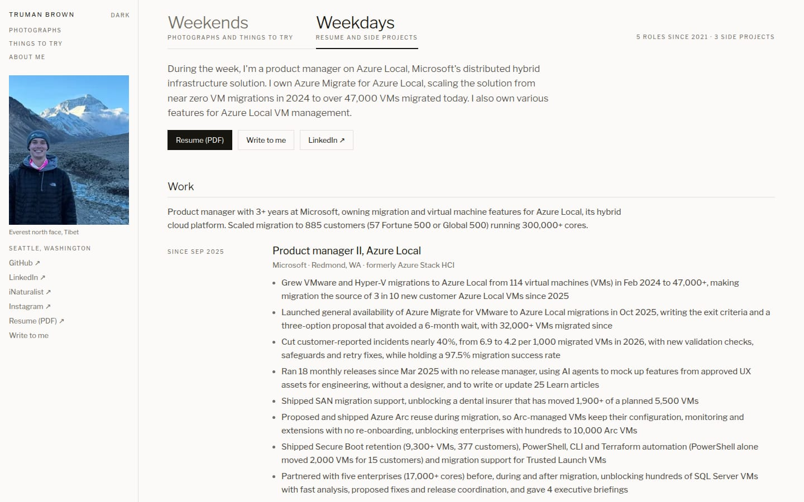
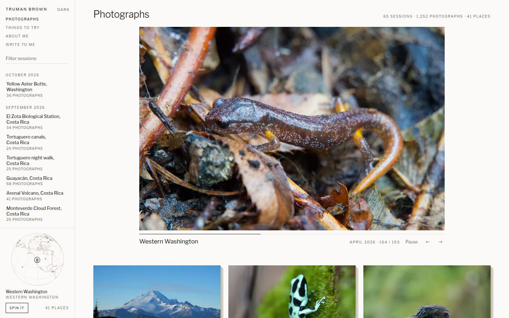

# photography-website

I'm [Truman Brown](https://trumanbrown.com/#weekdays), a product manager on Azure Local at Microsoft. This is the code for my site, trumanbrown.com: my resume, my wildlife, landscape and travel photography, and a few nature games.

[](https://github.com/TrumanBrown/photography-website/actions/workflows/build-and-deploy.yml)
[](https://github.com/TrumanBrown/photography-website/actions/workflows/lint.yml)
[](https://github.com/TrumanBrown/photography-website/actions/workflows/codeql.yml)

<a href="https://trumanbrown.com/#weekdays"><picture><source media="(prefers-color-scheme: dark)" srcset="docs/images/weekdays-dark.jpg"></picture></a>
<a href="https://trumanbrown.com/photographs/"><picture><source media="(prefers-color-scheme: dark)" srcset="docs/images/photographs-dark.jpg"></picture></a>

Try it: [the front door](https://trumanbrown.com/) (Weekends and Weekdays), [the photo archive](https://trumanbrown.com/photographs/), [Things to try](https://trumanbrown.com/hobbies/) (small interactive nature toys) and [Narrow nature](https://trumanbrown.com/hobbies/narrow-nature/), a daily puzzle where you guess where and when six species were seen together.

## What's worth a look

Three product calls, with why I made each one and what came of it.

Until November 2026 the site opened straight onto my photo archive, so someone coming from my resume or LinkedIn saw no picture of me and no line on what I do. I made `/` a front door with one switch, Weekends for the photographs and hobbies and Weekdays for my resume and side projects, and moved the archive to `/photographs/` ([the decisions](docs/product-experience.md#a-front-door-with-me-in-it-november-2026)). Its first four days had 60 views in 37 visits (some of them mine), a median of 13 seconds on the page, no referrer on 23 and nothing from LinkedIn, so a click from my resume looked the same as someone typing the address. Now the resume's links carry `?via=resume`, and the Analytics tab in `/admin` shows each Weekdays visit: how long it was on screen, how far down it got, what was clicked or copied, and the company when someone reads from their company's network. It emails me while a company is reading. None of it uses cookies or stores anyone's IP address ([docs/analytics.md](docs/analytics.md)).

Under the photographs, a vision model looks at each photo once, takes the species from my own iNaturalist observations and checks its facts against Wikipedia. That one record writes the site's captions and session descriptions, and three Instagram posts a day. The first Instagram captions read like alt text, so I rewrote a dozen of them by hand, and the generator learns from those rewrites ([two of them](#the-instagram-pipeline)). From October 10, 2026, when posting started, to October 27, the Instagram bio link sent 21 of the site's 208 visits, against 5 from every other site put together ([docs/photos.md](docs/photos.md), [docs/social.md](docs/social.md)).

Narrow nature is the site's daily puzzle. It asks you to read a whole community instead of one animal: six species that were all recorded at one real place in one month, shown most widely recorded first, and you guess where and when. I wanted it accurate enough to give to experts, so every clue is a research-grade iNaturalist record from that place and month, backed by at least two local records. The first people who played it were confused by the premise, so the premise and the instructions became the biggest thing on the page, and it was renamed from Day list to something that says what it is ([docs/hobbies.md](docs/hobbies.md#reference-implementation-narrow-nature-daily-puzzle)).

What I'd build next is in the [ranked roadmap](docs/product-experience.md#ranked-roadmap) of my product decision log.

On the engineering side:

- The site sends a strict Content Security Policy (hashed inline scripts, no `'unsafe-inline'` scripts) and HSTS preload, deploys through two least-privilege Azure identities with no stored keys, and pins every GitHub action to a commit. CodeQL, Dependabot and secret scanning with push protection watch the repo, and photos lose their GPS position before they're published ([docs/security.md](docs/security.md)).
- Every Azure resource is in Bicep and deploys from a manual workflow behind a GitHub environment ([docs/iac-bicep.md](docs/iac-bicep.md)).
- Builds run on every push and every hour, pick up new photos from Blob Storage, and move the image variants back to Blob so the Static Web Apps deploy stays a few megabytes. Azure sign-ins retry, so a GitHub token hiccup doesn't fail a deploy ([docs/cicd.md](docs/cicd.md)).
- It costs about $5 a month, domain included ([What it costs](#what-it-costs)).

## Quick links

The docs explain why each piece exists ([docs/architecture.md](docs/architecture.md)), and [docs/glossary.md](docs/glossary.md) explains every term.

| Topic | Doc |
|---|---|
| My product decision log: what changed, why, and the ranked roadmap | [docs/product-experience.md](docs/product-experience.md) |
| What is Astro, SWA, Blob, CDN, and why each one | [docs/architecture.md](docs/architecture.md) |
| What Azure resources exist, what each costs, and setting up your own copy | [docs/azure.md](docs/azure.md) |
| What Infrastructure-as-Code (Bicep) is and what each `.bicep` file does | [docs/iac-bicep.md](docs/iac-bicep.md) |
| How the GitHub Actions workflows work and why | [docs/cicd.md](docs/cicd.md) |
| How a photo travels from your camera to the live site | [docs/image-pipeline.md](docs/image-pipeline.md) |
| The Things to try section and its interactive islands | [docs/hobbies.md](docs/hobbies.md) |
| Editing session metadata from the browser (`/admin`) | [docs/admin.md](docs/admin.md) |
| Privacy-friendly traffic analytics (`/admin` Analytics tab) | [docs/analytics.md](docs/analytics.md) |
| Photo captions and session descriptions, written from the photos | [docs/photos.md](docs/photos.md) |
| Posting photos to Instagram a few a day, automatically | [docs/social.md](docs/social.md) |
| How the site is hardened (CSP, HSTS, CI identities, photo location) | [docs/security.md](docs/security.md) |
| Reporting a vulnerability | [SECURITY.md](SECURITY.md) |
| Running locally, adding a session, fixtures, tests | [docs/local-dev.md](docs/local-dev.md) |
| What personal info ends up in the public repo, and what doesn't | [docs/privacy.md](docs/privacy.md) |
| Picking the project up cold: setup on a new machine, scripts, open items | [docs/session-handoff.md](docs/session-handoff.md) |
| Glossary of every term used here | [docs/glossary.md](docs/glossary.md) |

## Tech at a glance

The site is a static Astro build on Azure Static Web Apps, with the photos in Azure Blob Storage. Drop a folder of photos into Blob and the next build picks them up.

- Frontend: Astro 7 and Tailwind v3, built to static pages ([docs/architecture.md](docs/architecture.md)).
- Things to try: canvas toys drawn in code (aquarium, tide pooling, fishing, birding selfie-to-bird, herping night drive, hiking trail studio) and the Narrow nature daily puzzle. Each card shows a stipple drawing made from my own photos ([docs/hobbies.md](docs/hobbies.md)).
- Dynamic API: the Functions in `api/`, bundled with Static Web Apps: the contact form, the admin API, the analytics beacon, link-preview images and the resume PDF ([docs/architecture.md](docs/architecture.md)).
- Admin and analytics: a browser `/admin` panel behind GitHub sign-in, and cookieless traffic metrics ([docs/admin.md](docs/admin.md), [docs/analytics.md](docs/analytics.md)).
- Hosting: Azure Static Web Apps, Free tier ([docs/azure.md](docs/azure.md)).
- Storage: Azure Blob Storage, in `originals`, `derivatives`, `variants` and `hobby-media`, plus the private `metadata` and `incoming` ([docs/image-pipeline.md](docs/image-pipeline.md)).
- Galleries: a session opens on a banner crop, then a justified grid. The lightbox always ends on the full-resolution original, image data untouched, and paints in about 80 ms while it loads ([docs/image-pipeline.md](docs/image-pipeline.md#viewing-full-resolution-without-the-wait)).
- Domain and DNS: Azure App Service Domain and Azure DNS.
- IaC: Bicep ([docs/iac-bicep.md](docs/iac-bicep.md)).
- CI/CD: GitHub Actions with OIDC federation and no long-lived secrets, a blob-only identity for builds and a separate one for the manual infra deploy ([docs/cicd.md](docs/cicd.md)).
- Cost: about $5 a month at personal traffic, `.com` domain included ([What it costs](#what-it-costs), [docs/azure.md](docs/azure.md#monthly-cost)).
- My name and other personal details in this repo: [docs/privacy.md](docs/privacy.md).

## The Instagram pipeline

The site also runs my photography Instagram: three photos a day plus a story, with nothing for me to do after an upload. The vision model's one look at each photo feeds the post too, the species comes from my own iNaturalist observation, and a Logic App timer publishes each post exactly once through Instagram's Graph API. Every caption points back to the full-resolution photo on the site.

Two of the captions I rewrote:

| The pipeline wrote | I rewrote it to |
| --- | --- |
| Groove-billed ani (Crotophaga sulcirostris) munching on an insect on a mossy post, Bijagua, Alajuela Province, Costa Rica. Such an interesting, unique beak on it. | Saw this Groove-billed ani (Crotophaga sulcirostris) munching on some insect in Bijagua. Such a unique bird, the beak goes so far up its head, almost looks like a horn lol 🐦 |
| Ran into this northwestern garter snake (Thamnophis ordinoides) with its mouth open among the grass and fallen leaves around Puget Sound. Can't tell what was going on, but that's such a big expression for a small snake lol 😅 | Ran into this northwestern garter snake (Thamnophis ordinoides) with some gunk on his jaws. Looks like he just finished a big meal, was pretty lethargic when moving 🐍 |

The rewrites live in two Markdown skills, [truman-voice](.github/skills/truman-voice/SKILL.md) and [caption-voice](.github/skills/caption-voice/SKILL.md), that go into the prompt with every batch of posts ([voice.mjs](scripts/photos/voice.mjs)). After a hundred posts in one template, code now picks each post's shape first (a few words, one sentence or a short story) and whether it ends on an emoji, so the feed doesn't read like a bot. Then it checks each opening before it's kept: no backstory my trip notes don't back up, no opener that repeats a recent post, no people, an emoji of the animal or the scene when there is one, and the species name filled in from the verified identification so it can't be wrong. The account isn't named anywhere in this repository. Setup and every rule: [docs/social.md](docs/social.md).

## Local development (TL;DR)

Full version in [docs/local-dev.md](docs/local-dev.md).

Use Node.js 22.23.4 or newer (the supported development line is Node 22).

```bash
npm ci
npm ci --prefix api
npm run fixtures           # only if you don't already have local sessions
npm run dev                # → http://localhost:4321
```

`npm run fixtures:many` generates ~40 sessions across 5 years so you can see how the sidebar feels at scale.

Before pushing, run what CI runs:

```bash
npm test                   # Vitest: site helpers, API functions, prebuild, photo + social pipelines, docs
npm run lint               # ESLint
npm run check              # CSP hash drift + astro check (types and content schemas)
npm run build              # production build into dist/
```

Setting up your own copy on Azure, from an empty subscription to a live domain: [docs/azure.md](docs/azure.md#first-time-setup). Uploading photos and editing a session's title, cover and captions: [docs/local-dev.md](docs/local-dev.md#adding-a-session).

## What it costs

The site costs about $5 a month to run. That's the bill for the month to
October 15, 2026, without the build's old downloads (below), plus a twelfth of
the domain's yearly fee. About $1.65 is photos sent to visitors, $1.50 is the
`.com` domain and its DNS zone, about $1.35 is storage requests, and the
remaining 55 cents is storage space, the caption model, an alert rule and the
posting timer. Emailing me a copy of each contact message adds a fraction of a
cent a message, and it sends at most ten an hour, so spam can't run it up.
Analytics adds about 40 cents: a timer that pings the site every five minutes
so the resume PDF and the visitor lookup are always ready, and resume alerts,
which share the contact email's hourly limit.
Details are in [docs/azure.md](docs/azure.md#monthly-cost).

The line Azure calls Bandwidth is data leaving the storage account. Anything
that reads a photo by its public URL counts. That's mostly visitors, about
19 GB a month, at $0.087/GB from the first GB on this subscription. The other
reader is the build. GitHub's runners are Azure VMs in other regions, so
whatever prebuild downloads from Blob is billed as transfer between regions,
at $0.02/GB.

From mid-September to mid-October 2026 that transfer was most of the bill.
Prebuild kept every photo at full size in its GitHub Actions cache, about
9 GB, and together with Astro's image cache that passed GitHub's limit of
10 GB per repository. GitHub then deleted one of the two caches on most runs,
and the next build downloaded the whole library again, 6 to 9 GB at a time and
more than 20 times on a busy day. Builds downloaded about 1,300 GB that month,
and $21.03 of the site's $26.31 bill was that transfer.

The build now reads a 2,400 px copy of each photo instead
([docs/image-pipeline.md](docs/image-pipeline.md#why-the-build-works-from-copies)).
No page shows an image wider than 2,000 px, and the lightbox still loads the
original straight from Blob, so visitors see the same photos. The copies come
to about 2 GB, so both caches fit with room to spare. A normal build downloads
nothing from storage, and one that starts with an empty cache downloads about
2 GB instead of 9. In the 11 hours after the change, builds downloaded 0.04 GB
from storage, against 86 GB in the 17 hours before it.

If the Bandwidth line climbs again, these show whether the build is the cause:

```bash
gh cache list   # prebuild-cache-* about 1.9 GB, astro-cache-v2-* about 1.5 GB
az monitor metrics list \
  --resource "$(az storage account show -n <storage-account> --query id -o tsv)/blobServices/default" \
  --metric Egress --interval P1D --aggregation Total --filter "Authentication eq '*'"
```

In the Egress numbers, `OAuth` is the build and anything else signed in to
Azure, like a local prebuild, and `Anonymous` is photos read by public URL,
mostly by visitors. The subscription has no budget alert. Cost Management can
email you when the month's forecast passes an amount you set.

## Repository layout

```
photography-website/
├── .github/
│   ├── actions/
│   │   ├── azure-login/       # OIDC sign-in to Azure, with retries
│   │   └── image-tools/       # RAW, HEIC and GPS tools for the build, installed from a cache
│   ├── instructions/          # design and copy rules for every public page and string
│   ├── skills/                # agent skills, one per part of the site (how it works, my verdicts,
│   │                          # lessons learned), plus my writing voice and the card drawings
│   └── workflows/             # CI/CD and CodeQL, see docs/cicd.md
├── api/                       # the Functions in api/, bundled with Static Web Apps
│   ├── contact/               # "Write to me", and an email copy of each message
│   ├── og/                    # link-preview images, counted as shares
│   ├── resume/                # the resume PDF, counted as it's opened
│   ├── sessionmgr/            # the admin API: sessions, messages, analytics
│   ├── shared/                # helpers the functions share
│   └── track/                 # the analytics beacon
├── docs/                      # detailed docs (this README is the index), images/ holds its screenshots
├── infra/                     # Bicep IaC, see docs/iac-bicep.md
├── public/                    # files served as they are: the resume PDF, fonts, the birding face model, map tiles
├── scripts/                   # prebuild, upload + bootstrap scripts, photos/ (captions), social/ (Instagram)
├── src/
│   ├── assets/                # committed images: stipple drawings, my portrait, fishing catch photos
│   ├── components/            # Astro components (Header, ArchiveRail, Lightbox, PlateArt, …)
│   │   ├── about/             # the front door's rail, resume and side projects
│   │   └── hobbies/           # interactive island mounts, one per hobby
│   ├── content/               # content collections (sessions generated by prebuild, hobbies committed)
│   ├── layouts/               # the page shell
│   ├── lib/                   # blob URLs, sessions, archive + globe, theme, admin, analytics
│   │   ├── hobbies/           # canvas engines and their data (zero runtime dependencies)
│   │   └── scenes/            # the scene each hobby card plays when it's clicked
│   ├── pages/                 # one file or folder per route
│   │   ├── .well-known/       # security.txt
│   │   ├── admin/             # /admin/, the admin panel (its API needs GitHub sign-in)
│   │   ├── hobbies/           # /hobbies/ (Things to try) and a page per hobby
│   │   ├── og/                # /og/<slug>.jpg, preview images for the hobby pages
│   │   ├── photographs/       # /photographs/, the photo archive
│   │   ├── places/            # /places/<region>/, sessions by place
│   │   ├── sessions/          # /sessions/<slug>/, one page per session
│   │   ├── index.astro        # /, the front door with its Weekends and Weekdays sides
│   │   ├── prints.astro       # /prints/, prints and licensing
│   │   └── privacy.astro      # /privacy/
│   └── styles/                # global.css, the Tailwind entry and the site's own styles
├── staging/                   # gitignored drop zone for photos before upload (README kept)
├── site.config.ts             # display config (committed; not for secrets)
├── site.config.example.ts     # template for new clones
├── staticwebapp.config.json   # SWA headers + routing, see docs/security.md
└── README.md                  # this file
```

## License

The **source code** in this repository is licensed under the MIT License. See [LICENSE](LICENSE).

The **photographs, graphics, and written content** are not covered by that license. All photographs and images on the site are © Truman Brown, all rights reserved, and are not licensed for reuse. The photos themselves are not stored in this repository; they live in Azure Blob Storage and are served to the site at build time.

Third-party content carries its own terms: the tide-pooling reveal cards can show Creative Commons photos from iNaturalist with attribution shown in the card, and those remain under their respective CC licenses. See [docs/hobbies.md](docs/hobbies.md) for details.
