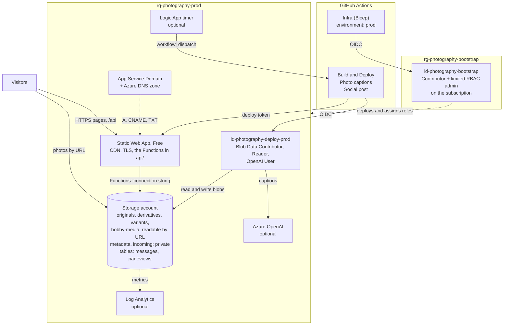

# Azure architecture and resources

> Concise reference. For why we picked Astro/SWA/Blob over alternatives, see [architecture.md](architecture.md). For what each `.bicep` file actually does, see [iac-bicep.md](iac-bicep.md). To set up your own copy from an empty subscription, see [First-time setup](#first-time-setup).

## Architecture in one diagram



Two paths to the visitor: optimized responsive variants are generated during
the Astro build and moved to Blob before deployment; full-resolution originals
also stay in Blob and load only when the lightbox opens. SWA serves the HTML,
CSS, JavaScript, and other small static assets, and runs the Functions in
`api/` (the contact form, the analytics beacon, the admin API, link-preview
images and the resume PDF). Every photo is stripped of its GPS
position before it's readable by URL ([security.md](security.md#photo-locations)).

The two identities exist so the workflows that run third-party code can only
touch blobs, while the one that can change the subscription runs only the
manual Infra deploy ([cicd.md](cicd.md#two-identities-least-privilege-by-job)).

---

## Resources Bicep creates

All inside resource group `rg-photography-prod`, except the bootstrap identity (last row), which the setup script creates outside Bicep.

| Resource | Purpose |
|---|---|
| **Storage account** `stphoto<env><suffix>` | Holds photos, variants, Table Storage, and build state. LRS, hot tier. Shared-key access is enabled only because SWA Free Functions require a connection string; CI uses OIDC. |
| ↳ Container `originals` | Your uploads. Public-read by URL, no listing. |
| ↳ Container `derivatives` | RAW→JPEG sidecars written by the build. Same access. |
| ↳ Container `variants` | Responsive WebP/JPEG outputs and tiny admin thumbnails. Same access. |
| ↳ Container `hobby-media` | Full/display hobby-gallery photos, kept separate from sessions. Same access. |
| ↳ Container `metadata` | Private. Build manifest, the admin index, the 2,400 px copies the build reads instead of the originals (`build-copies/`), the photo pipeline's records (`photos/`) and the Instagram poster's state (`social/`). |
| ↳ Container `incoming` | Private. New uploads wait here until the build removes any GPS position and publishes them to `originals` or `hobby-media`. |
| ↳ Tables | Contact messages, pageviews, and hashed contact rate-limit counters. Bicep creates `contactmessages`; the Functions create the other two on first write. |
| **Static Web App** `swa-photography-prod` (Free SKU) | Hosting + global CDN + auto-TLS + PR previews. |
| ↳ Custom domain bindings (apex + `www`) | Created by [scripts/bind-domain.sh](../scripts/bind-domain.sh) after the domain is registered, not by Bicep (the apex validation token only exists once binding starts). |
| **User-assigned managed identity** `id-photography-deploy-<env>` | The build identity: Build and Deploy, Photo captions and Social post sign in as it via OIDC (`AZURE_DEPLOY_CLIENT_ID`). RBAC: `Storage Blob Data Contributor` on the storage account, `Reader` on the RG, and `Cognitive Services OpenAI User` on the Azure OpenAI account when that's deployed. No table access. |
| ↳ Federated credentials `github-main`, `github-pull-request` | Trust JWTs from this specific repo + branch. No long-lived secrets. |
| **Azure OpenAI account** `oai-photography-<env>-<suffix>` | Created only when `enableDescribeModel=true`. One model deployment (`gpt-6.1-sol`, US data zone) that the photo pipeline uses to look at each photo once and write captions and session descriptions ([docs/photos.md](photos.md)). API keys are disabled; workflows reach it through their OIDC login, with inference-only access. |
| **Communication Services** `acs-photography-<env>-<suffix>` and **Email Communication Service** `email-photography-<env>-<suffix>` | Created only when `enableContactEmail=true`. Emails you a copy of each contact form message from an Azure-managed sending address (`DoNotReply@<id>.azurecomm.net`), so there's no DNS to set up. See [Contact form email](#contact-form-email). |
| **Logic App** `logic-photography-<env>-warmup` | Created only when `enableApiWarmup=true`. Calls `GET /api/track?warm=1` every five minutes so the analytics network lookup and the resume PDF never wait on a cold start ([docs/analytics.md](analytics.md#warm-up-ping)). No secrets. |
| **Logic App** `logic-photography-<env>-scheduler` | Created only when `enableSocialScheduler=true`. A timer that starts the Instagram posting and photo workflows on GitHub, because GitHub's own scheduler skips many runs ([docs/social.md](social.md#what-runs-automatically)). Uses the Static Web App's `GITHUB_TOKEN` setting. |
| **App Service Domain** `yourdomain.com` | `.com` registration. Only created when `domainName` is set; first-time purchase needs `az appservice domain create --accept-terms` once. |
| **Azure DNS zone** `yourdomain.com` | Holds `A` (apex → SWA), `CNAME` `www`, `TXT` (SWA ownership token). |
| **Log Analytics workspace** `log-photography-prod` | Created only when `enableDiagnostics=true`; receives storage transaction metrics with a 1 GB/day cap. |
| **Bootstrap identity** `id-photography-bootstrap` (resource group `rg-photography-bootstrap`) | Created by [scripts/setup-federated-credential.sh](../scripts/setup-federated-credential.sh), not Bicep. The identity the Infra workflow deploys as: `Contributor` on the subscription, plus `Role Based Access Control Administrator` limited to assigning the build identity's roles. Trusts only the `prod` GitHub Environment. |

Full module-by-module breakdown: [iac-bicep.md#what-the-bicep-deploys-resource-by-resource](iac-bicep.md#what-the-bicep-deploys-resource-by-resource).

---

## Monthly cost

Measured from the bill for September 16 to October 15, 2026, without the build's own downloads, which stopped on October 16 ([image-pipeline.md](image-pipeline.md#why-the-build-works-from-copies)). About 17 GB stored and about 19 GB a month read by public URL. Region `westus3`.

| Service | Tier / Usage | Monthly |
|---|---|---|
| Static Web Apps | Free tier (100 GB bandwidth, TLS, PR previews) | $0.00 |
| Blob capacity | About 17 GB hot LRS @ ~$0.018/GB | $0.31 |
| Blob requests | About 2.7M a month, most of them the build checking which page images and admin thumbnails are already uploaded (about 15,000 per build) | $1.35 |
| Egress | About 19 GB a month read by public URL, mostly by visitors, at $0.087/GB from the first GB (this subscription gets no free 100 GB). Builds run on GitHub's runners, Azure VMs in other regions, so what they download is $0.02/GB: they read 2,400 px build copies, about 2 GB when their cache is cold | $1.66 |
| App Service Domain (`.com`) | $11.99/yr amortized | ~$1.00 |
| Azure DNS zone | 1 zone @ $0.50 | $0.49 |
| Log Analytics | Not created by default; free allowance covers optional storage diagnostics | $0.00 |
| Azure OpenAI (optional) | Pay per use: about $10–15 once for an 800-photo archive, then cents per new session, nothing while idle | $0.14 |
| Azure Monitor alert | One metric alert rule (new contact message), made by hand before the email copy existed | $0.10 |
| Communication Services email (optional) | $0.00025 a message plus $0.00012 a MB, capped at ten an hour | under $0.01 |
| Logic App timer (optional) | Consumption, about 1,000 runs a month | $0.01 |
| Logic App warm-up ping (optional) | Consumption, about 8,600 runs a month, one HTTP action each, past the free allowance | ~$0.35 |
| Analytics lookup files | DB-IP Lite, about 65 MB in `metadata/geo/`, read once per cold Functions instance | under $0.05 |
| Bicep deployments | Always free | $0.00 |
| **Total** | | **~$5.45** |

At 10× the traffic and 100 GB stored it would be about $23 a month, mostly egress, and still well inside the $150/mo credits.

### Contact form email

Each message someone sends through "Write to me" is saved in the
`contactmessages` table first, then [api/contact/notify.js](../api/contact/notify.js)
emails a copy to you, with the sender as the Reply-To, so answering is just
replying. The email goes out through Azure Communication Services
([infra/modules/email.bicep](../infra/modules/email.bicep)), using an
Azure-managed sending domain, so there's no DNS record to add.

It needs three app settings on the Static Web App:

| Setting | What it is | Set by |
|---|---|---|
| `CONTACT_EMAIL_CONNECTION_STRING` | The Communication Services resource's connection string | The Infra workflow, from the resource |
| `CONTACT_EMAIL_FROM` | Its sender, `DoNotReply@<id>.azurecomm.net` | The Infra workflow, from the Bicep output |
| `CONTACT_NOTIFY_TO` | The inbox that gets the copy | The Infra workflow, from the `CONTACT_NOTIFY_EMAIL` GitHub secret. Without that secret it keeps whatever is already set |

To turn it on for a new copy of the site: set `enableContactEmail` to `true`
in `infra/main.parameters.json`, add the `CONTACT_NOTIFY_EMAIL` secret
(`gh secret set CONTACT_NOTIFY_EMAIL`), register the resource provider once
(`az provider register -n Microsoft.Communication`), then run Infra. Until all
three settings exist, the form keeps saving messages and simply sends no email.

Sending is best effort. The message is already saved when the email goes out,
so if Communication Services is down the visitor still sees "Message sent" and
the message waits in the table. At most ten emails go out an hour across all
visitors, which is also the most an Azure-managed domain allows, so spam can't
run up the bill. The admin panel's messages tab still shows everything.

The metric alert `new-contact-message` (and its action group `contact-notify`)
was made by hand before this, and sends a generic "a table was written to"
email. With the copy in place it's redundant. Delete both in the portal when
you're happy the copies arrive.

### What we deliberately don't use

| Skipped | Why |
|---|---|
| Front Door Standard (~$35/mo) | SWA's free CDN already does global edge caching. |
| WAF | Needs Front Door. Current bounded Functions already use throttling and allowlisted auth; the edge tier is disproportionate at personal traffic. |
| Plausible/Fathom (~$9/mo) | The first-party Table Storage analytics pipeline covers the small metric set needed. |
| Azure Key Vault | The few runtime credentials fit SWA's encrypted app settings; Key Vault would add cost and integration without reducing current privilege. |

---

## First-time setup

The minimal sequence for a copy of the site on your own subscription. The resources it creates are listed above, and [cicd.md](cicd.md) explains the workflows and identities.

### 0. Prereqs

- Azure CLI (`az`) installed and `az login` done
- GitHub CLI (`gh`) installed and `gh auth login` done (logged in as the GitHub account that owns the repo)
- An empty GitHub repo created and this code pushed to `main`
- The subscription ID + tenant ID of your Azure subscription

### 1. Fill in placeholders

Edit [site.config.ts](../site.config.ts):
- `ownerName`, your full name (drives the footer, page metadata and structured data; **becomes public when you push**)
- `siteTitle`, the site's name: the front page's tab title and the start of every other tab ("Jane Doe | Photographs"); `siteDescription`, taste
- `domain`, apex domain you'll register (e.g. `<yourname>.com`)
- `copyrightStartYear`, current year on first deploy
- `prints`, `true` to take print and licensing inquiries: a Prints button on session photos, a `/prints` page in the footer, and licensing data for Google Images. Inquiries arrive through the contact form; there's no shop. Set `false` if you don't sell prints. Details in [product-experience.md](product-experience.md#prints-and-licensing-inquiries).

Edit [infra/main.parameters.json](../infra/main.parameters.json):
- `githubOwner`, your GitHub username/org
- `domainName`, leave `""` on first deploy if you want infra up before registering a domain; fill in and re-deploy later

> Full inventory of what becomes public and what stays private: [privacy.md](privacy.md).

### 2. Bootstrap the deploy identity

```bash
./scripts/setup-federated-credential.sh <subscription-id> <github-owner> <github-repo>
```

It prints three values. Add them as repo secrets (Settings → Secrets and variables → Actions):
- `AZURE_CLIENT_ID`
- `AZURE_TENANT_ID`
- `AZURE_SUBSCRIPTION_ID`

This identity can change the whole subscription, so it trusts only the `prod`
GitHub Environment that the Infra workflow deploys from. Create that environment
under **Settings → Environments** and limit its deployment branches to `main`.
Everything else (builds, captions, Instagram) signs in as a second identity that
the first Infra run creates, with access to the site's blobs only. What this
does and why: [cicd.md](cicd.md#two-identities-least-privilege-by-job).

### 3. (Optional) Add a PAT for secret auto-write

If you want the **Infra (Bicep)** workflow to auto-write `AZURE_STATIC_WEB_APPS_API_TOKEN`, `AZURE_STORAGE_ACCOUNT` and `AZURE_DEPLOY_CLIENT_ID` (the build identity) back into repo secrets, add a fine-grained PAT with `Secrets: read/write` on this repo as `GH_PAT_FOR_SECRETS`. Otherwise run `./scripts/bootstrap-swa-token.sh <resource-group> <swa-name> <owner/repo>` by hand after the first deploy.

### 4. Run the Infra workflow

GitHub → **Actions** tab → **Infra (Bicep)** → **Run workflow** → environment `prod`.

This deploys the whole Azure stack. Everything it creates is enumerated in [iac-bicep.md](iac-bicep.md#what-the-bicep-deploys-resource-by-resource).
It also configures the SWA Functions with the storage connection, a private
analytics salt, and the GitHub user who ran the workflow as the initial admin.

Bicep doesn't give your own Azure account access to the photos, and being the
subscription's Owner isn't enough. To upload sessions from your machine, give
yourself `Storage Blob Data Contributor` on the storage account once. It takes
about five minutes to apply:

```bash
az role assignment create --assignee <your sign-in name> --role "Storage Blob Data Contributor" \
  --scope "$(az storage account show -n <storage-account> --query id -o tsv)"
```

### 5. Register the domain (interactive, one-time)

```bash
az appservice domain create \
  --resource-group rg-photography-prod \
  --hostname yourdomain.com \
  --contact-info @contact.json \
  --accept-terms
```

`contact.json` format: <https://learn.microsoft.com/azure/app-service/manage-custom-dns-buy-domain>. **Gitignored**: never commit it.

Then set `domainName` in `infra/main.parameters.json` and re-run the Infra workflow, then bind the apex/www domains:

```bash
./scripts/bind-domain.sh rg-photography-prod swa-photography-prod yourdomain.com
```

### 6. Update `site.config.ts` with the real Blob host

After the first infra deploy, set `blobHost` in [site.config.ts](../site.config.ts) to the actual storage account hostname (printed in the deploy output), and put the same host in the two `blob.core.windows.net` sources of the Content-Security-Policy in [staticwebapp.config.json](../staticwebapp.config.json) (`npm run check:csp` fails until they match). For uploads, set `AZURE_STORAGE_ACCOUNT` in `.env`. Commit and push.

### 7. Tell Google about the site (optional)

In [Google Search Console](https://search.google.com/search-console), add a Domain property for your domain and put the TXT value it gives you at the apex, beside the Static Web Apps token:

```bash
az network dns record-set txt add-record -g rg-photography-prod -z yourdomain.com -n @ \
  --value "google-site-verification=<value from Google>"
```

Never delete the apex TXT record set: both values live in it. Once Google verifies the domain, submit `https://yourdomain.com/sitemap-index.xml` and `https://yourdomain.com/image-sitemap.xml`. "Couldn't fetch" right after a push usually means a deploy was running, so submit again later. The aim is for session pages to come up when people search the places in their titles.

---

## Future extensibility

Each of these can be added later without touching anything above.

- **Admin upload UI:** SWA supports managed auth (GitHub/Entra/OIDC) + serverless `/api/*` functions. Add an auth-gated route that streams to Blob. Same SWA, no new hosting tier.
- **iCloud sync:** separate scheduled GitHub Action or Azure Function that writes blobs to `originals/`. Site code reacts to new blobs on the next build, no integration.
- **Sub-minute refresh:** Azure Event Grid → tiny Function → GitHub `repository_dispatch: blob-changed`. The build workflow already accepts that trigger.
- **Login-gated originals:** every blob URL flows through [src/lib/blob.ts](../src/lib/blob.ts). Swap to SAS URLs there and the rest of the site is unchanged.
