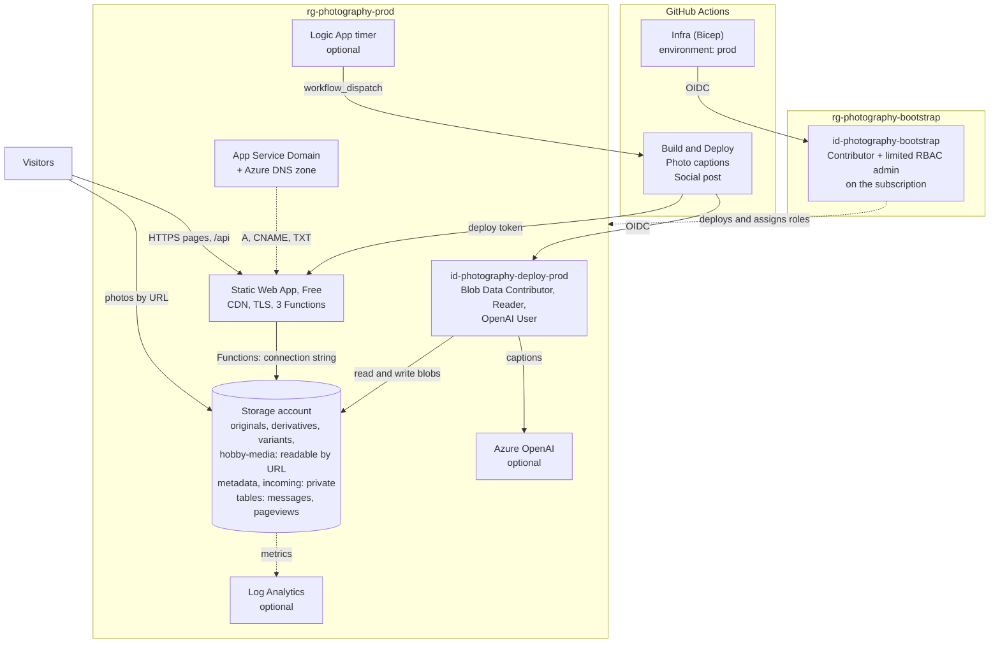

# Azure architecture and resources

> Concise reference. For why we picked Astro/SWA/Blob over alternatives, see [architecture.md](architecture.md). For what each `.bicep` file actually does, see [iac-bicep.md](iac-bicep.md).

## Architecture in one diagram

Two paths to the visitor: optimized responsive variants are generated during
the Astro build and moved to Blob before deployment; full-resolution originals
also stay in Blob and load only when the lightbox opens. SWA serves the HTML,
CSS, JavaScript, and other small static assets, and runs the three Functions
(contact form, analytics beacon, admin API). Every photo is stripped of its GPS
position before it's readable by URL ([security.md](security.md#photo-locations)).

The two identities exist so the workflows that run third-party code can only
touch blobs, while the one that can change the subscription runs only the
manual Infra deploy ([cicd.md](cicd.md#two-identities-least-privilege-by-job)).

---

## Resources Bicep creates

All inside resource group `rg-photography-prod`, except the bootstrap identity (last row), which the setup script creates outside Bicep.

| Resource | Purpose |
|---|---|
| **Storage account** `stphoto<env><suffix>` | Holds photos, variants, Table Storage, and build state. LRS, hot tier. Shared-key access is enabled only because SWA Free Functions require a connection string; CI uses OIDC. |
| ↳ Container `originals` | Your uploads. Public-read by URL, no listing. |
| ↳ Container `derivatives` | RAW→JPEG sidecars written by the build. Same access. |
| ↳ Container `variants` | Responsive WebP/JPEG outputs and tiny admin thumbnails. Same access. |
| ↳ Container `hobby-media` | Full/display hobby-gallery photos, kept separate from sessions. Same access. |
| ↳ Container `metadata` | Private. Build manifest, the admin index, the 2,400 px copies the build reads instead of the originals (`build-copies/`), the photo pipeline's records (`photos/`) and the Instagram poster's state (`social/`). |
| ↳ Container `incoming` | Private. New uploads wait here until the build removes any GPS position and publishes them to `originals` or `hobby-media`. |
| ↳ Tables | Contact messages, pageviews, and hashed contact rate-limit counters. Bicep creates `contactmessages`; the Functions create the other two on first write. |
| **Static Web App** `swa-photography-prod` (Free SKU) | Hosting + global CDN + auto-TLS + PR previews. |
| ↳ Custom domain bindings (apex + `www`) | Created by [scripts/bind-domain.sh](../scripts/bind-domain.sh) after the domain is registered, not by Bicep (the apex validation token only exists once binding starts). |
| **User-assigned managed identity** `id-photography-deploy-<env>` | The build identity: Build and Deploy, Photo captions and Social post sign in as it via OIDC (`AZURE_DEPLOY_CLIENT_ID`). RBAC: `Storage Blob Data Contributor` on the storage account, `Reader` on the RG, and `Cognitive Services OpenAI User` on the Azure OpenAI account when that's deployed. No table access. |
| ↳ Federated credentials `github-main`, `github-pull-request` | Trust JWTs from this specific repo + branch. No long-lived secrets. |
| **Azure OpenAI account** `oai-photography-<env>-<suffix>` | Created only when `enableDescribeModel=true`. One model deployment (`gpt-6.1-sol`, US data zone) that the photo pipeline uses to look at each photo once and write captions and session descriptions ([docs/photos.md](photos.md)). API keys are disabled; workflows reach it through their OIDC login, with inference-only access. |
| **Logic App** `logic-photography-<env>-scheduler` | Created only when `enableSocialScheduler=true`. A timer that starts the Instagram posting and photo workflows on GitHub, because GitHub's own scheduler skips many runs ([docs/social.md](social.md#what-runs-automatically)). Uses the Static Web App's `GITHUB_TOKEN` setting. |
| **App Service Domain** `yourdomain.com` | `.com` registration. Only created when `domainName` is set; first-time purchase needs `az appservice domain create --accept-terms` once. |
| **Azure DNS zone** `yourdomain.com` | Holds `A` (apex → SWA), `CNAME` `www`, `TXT` (SWA ownership token). |
| **Log Analytics workspace** `log-photography-prod` | Created only when `enableDiagnostics=true`; receives storage transaction metrics with a 1 GB/day cap. |
| **Bootstrap identity** `id-photography-bootstrap` (resource group `rg-photography-bootstrap`) | Created by [scripts/setup-federated-credential.sh](../scripts/setup-federated-credential.sh), not Bicep. The identity the Infra workflow deploys as: `Contributor` on the subscription, plus `Role Based Access Control Administrator` limited to assigning the build identity's roles. Trusts only the `prod` GitHub Environment. |

Full module-by-module breakdown: [iac-bicep.md#what-the-bicep-deploys-resource-by-resource](iac-bicep.md#what-the-bicep-deploys-resource-by-resource).

---

## Monthly cost

Measured from the bill for September 16 to October 15, 2026, without the build's own downloads, which stopped on October 16 ([image-pipeline.md](image-pipeline.md#why-the-build-works-from-copies)). About 17 GB stored and about 19 GB a month read by public URL. Region `westus3`.

| Service | Tier / Usage | Monthly |
|---|---|---|
| Static Web Apps | Free tier (100 GB bandwidth, TLS, PR previews) | $0.00 |
| Blob capacity | About 17 GB hot LRS @ ~$0.018/GB | $0.31 |
| Blob requests | About 2.7M a month, most of them the build checking which page images and admin thumbnails are already uploaded (about 15,000 per build) | $1.35 |
| Egress | About 19 GB a month read by public URL, mostly by visitors, at $0.087/GB from the first GB (this subscription gets no free 100 GB). Builds run on GitHub's runners, Azure VMs in other regions, so what they download is $0.02/GB: they read 2,400 px build copies, about 2 GB when their cache is cold | $1.66 |
| App Service Domain (`.com`) | $11.99/yr amortized | ~$1.00 |
| Azure DNS zone | 1 zone @ $0.50 | $0.49 |
| Log Analytics | Not created by default; free allowance covers optional storage diagnostics | $0.00 |
| Azure OpenAI (optional) | Pay per use: about $10–15 once for an 800-photo archive, then cents per new session, nothing while idle | $0.14 |
| Azure Monitor alert | One metric alert rule (new contact message) | $0.10 |
| Logic App timer (optional) | Consumption, about 1,000 runs a month | $0.01 |
| Bicep deployments | Always free | $0.00 |
| **Total** | | **~$5.05** |

At 10× the traffic and 100 GB stored it would be about $23 a month, mostly egress, and still well inside the $150/mo credits.

### What we deliberately don't use

| Skipped | Why |
|---|---|
| Front Door Standard (~$35/mo) | SWA's free CDN already does global edge caching. |
| WAF | Needs Front Door. Current bounded Functions already use throttling and allowlisted auth; the edge tier is disproportionate at personal traffic. |
| Plausible/Fathom (~$9/mo) | The first-party Table Storage analytics pipeline covers the small metric set needed. |
| Azure Key Vault | The few runtime credentials fit SWA's encrypted app settings; Key Vault would add cost and integration without reducing current privilege. |

---

## Future extensibility

Each of these can be added later without touching anything above.

- **Admin upload UI:** SWA supports managed auth (GitHub/Entra/OIDC) + serverless `/api/*` functions. Add an auth-gated route that streams to Blob. Same SWA, no new hosting tier.
- **iCloud sync:** separate scheduled GitHub Action or Azure Function that writes blobs to `originals/`. Site code reacts to new blobs on the next build, no integration.
- **Sub-minute refresh:** Azure Event Grid → tiny Function → GitHub `repository_dispatch: blob-changed`. The build workflow already accepts that trigger.
- **Login-gated originals:** every blob URL flows through [src/lib/blob.ts](../src/lib/blob.ts). Swap to SAS URLs there and the rest of the site is unchanged.
